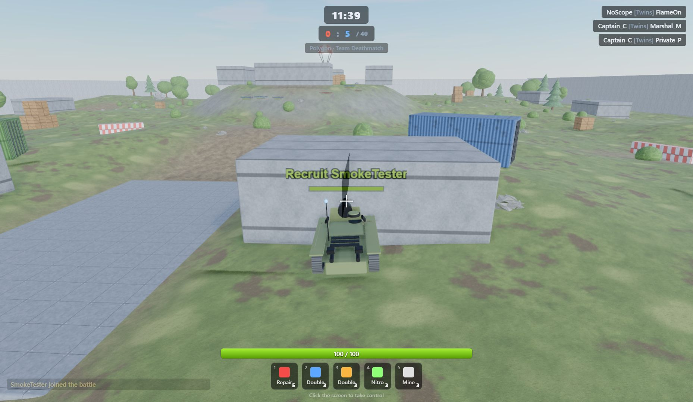
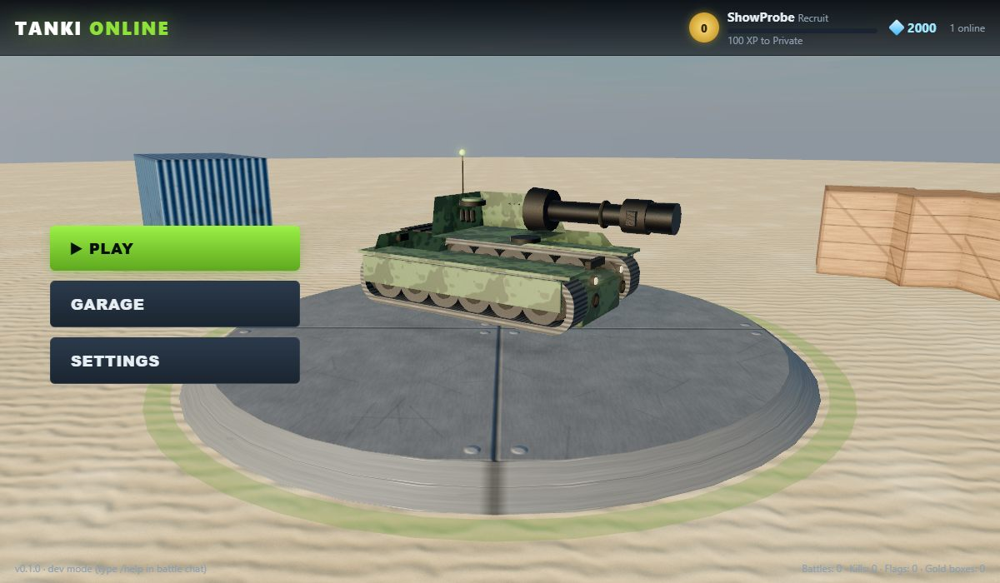

# Tanki Online (desktop)

A Tanki Online style 3D tank battle game for Windows desktop. Electron shell, three.js renderer, cannon-es physics,
authoritative Node.js battle server with bots. Visuals use scanned CC0 assets (ambientCG PBR textures, Poly Haven HDRI
skies and props, an OpenGameArt tank) prepared by a small asset pipeline; sounds are generated procedurally.




## Features

- **Garage**: 7 hulls (Wasp, Hornet, Hunter, Viking, Dictator, Titan, Mammoth), 12 turrets (Smoky, Firebird, Twins, Isida,
  Railgun, Freeze, Thunder, Hammer, Ricochet, Striker, Vulcan, Shaft), 14 paints with turret resistances, M0–M3
  modifications, supplies shop, live 3D preview.
- **Battle modes**: Deathmatch, Team Deathmatch, Capture the Flag, Control Points and Juggernaut on 7 maps (Sandbox,
  Polygon, Silence, Kungur, Ruins, Canyon, Frontier). Quick play, a battle list, or create your own battle with custom
  time/score limits, bot count, friendly fire, supplies and drops.
- **Progression**: 30 ranks from Recruit to Generalissimo, experience from kills, assists, flags and points, crystals from
  the battle fund, gold boxes, rank-up bonuses, three daily missions with crystal rewards, a leaderboard and a guided
  training battle with a one-time reward. Profiles are saved per nickname.
- **Supplies and drops**: repair kit, double armor, double damage, nitro, mines, parachuted supply drops and the gold box.
- **Bots**: A* navigation over a generated nav grid, objective play per mode, weapon-specific engagement ranges, supply use.
- **Rendering**: HDRI skies that also light the scene (PMREM image based lighting, sun placed along the brightest pixel of the
  sky, fog from its horizon colour), scanned PBR texture sets with normal/roughness/AO maps, three-layer terrain blending,
  GPU blade grass that bends in the wind and around the tank, scanned props and trees, a CC0 Abrams model fitted to every
  hull class, AgX tone mapping, ambient occlusion, bloom, soft shadows, CSS2D nameplates, a spring-arm camera that never
  clips into walls and a sniper view for the Shaft. Quality steps down automatically when the frame rate drops.
- **Multiplayer ready**: the battle server is authoritative and speaks JSON over WebSocket; run it on a LAN host and
  point several clients at it.

## Run

```bash
npm install
npm start            # desktop app with embedded server (dev mode, chat commands enabled)
npm run server       # standalone server on http://0.0.0.0:8081 (open it in Chrome, or from other PCs on the LAN)
npm test             # unit + simulation tests
node tools/e2e.mjs   # headless Chrome end-to-end flow (needs a server on 127.0.0.1:8090)
npm run dist         # build dist/TankiOnline-win32-x64/TankiOnline.exe
```

The desktop app starts its own server on a random local port and stores profiles under
`%APPDATA%\tanki-online\data\profiles`. The standalone server stores them in `./data/profiles`.

## Controls

| Action | Keys |
| --- | --- |
| Drive | W A S D or arrow keys |
| Aim turret | Mouse (mouse mode) or Z / X (keyboard mode), C centres the turret |
| Fire | Left mouse button or Space (hold to charge the Shaft) |
| Supplies | 1 repair, 2 double armor, 3 double damage, 4 nitro, 5 mine |
| Toggle mouse / keyboard aiming | F |
| Scoreboard | Tab (hold) |
| Chat / team chat | Enter / T |
| Zoom | Mouse wheel, + / - |
| Self destruct | Delete |
| Menu | Esc |

In dev mode (`npm start` or `--dev`) type `/help` in battle chat for cheats (`/crystals`, `/xp`, `/unlock`, `/supplies`, `/bots N`, `/end`).

## Assets

`client/assets/` holds the CC0 textures, HDRIs and models (about 35 MB). `node tools/assets.mjs` downloads and prepares
them again from ambientCG and Poly Haven (resize with sharp, mesh simplification and WebP textures with glTF-Transform);
`tools/blender/split_tank.py` splits the OpenGameArt Abrams into hull, turret and gun with Blender. Sources and licences
are listed in `client/assets/CREDITS.md`.

## Project layout

```
shared/        catalog, maps, protocol and the simulation (physics, weapons, navigation) used by server and client
server/        battle rooms, bots, profiles, garage transactions, HTTP + WebSocket server
client/        three.js client: rendering, effects, HUD, menus, garage; client/assets = CC0 textures, HDRIs, models
electron/      desktop shell (embedded server + window)
tests/         node:test suites
tools/         packaging, screenshot and end-to-end helpers
```

## Licence

MIT. Tanki Online is a trademark of its respective owner; this is an independent fan-made game with no affiliation.
